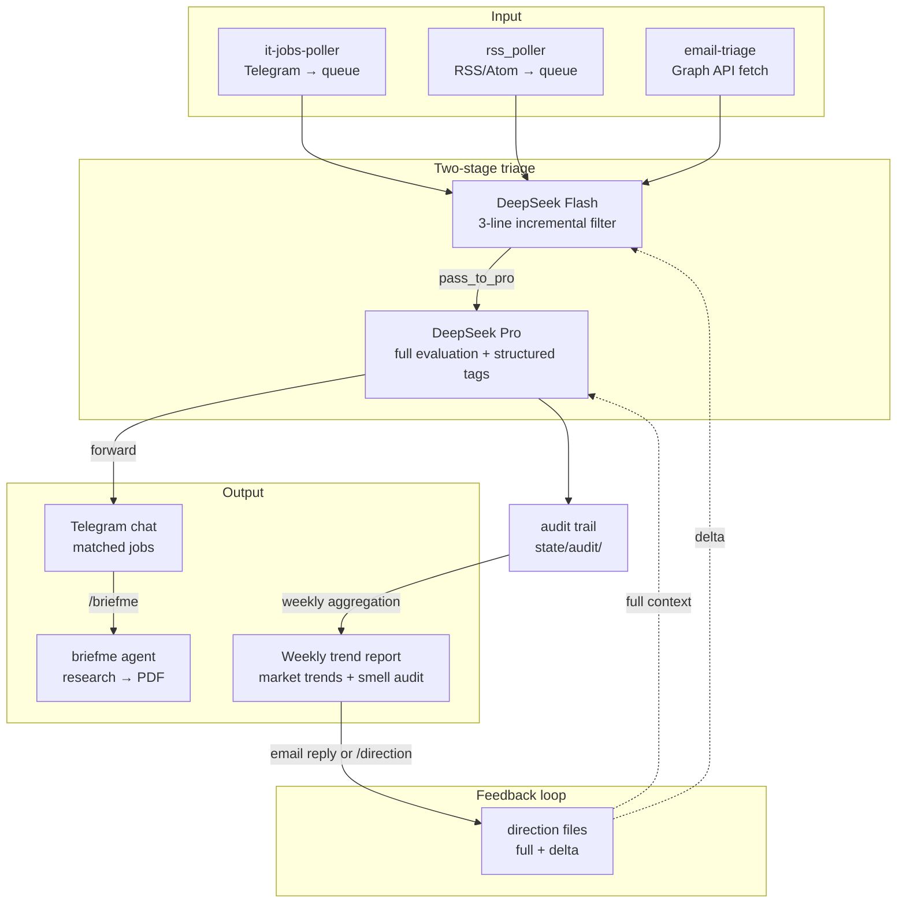

# telegram_MCP

Start here: [repository orientation and safe verification](ORIENTATION.md).

[](https://github.com/mknull/tg-infra/actions/workflows/ci.yml)

A self-contained job-market intelligence pipeline. Monitors Telegram groups, RSS/Atom job feeds, and Outlook folders, runs a two-stage DeepSeek triage to filter vacancies for relevance, delivers matches to a private Telegram chat, and adapts to user feedback over time. Built to run unattended under systemd.

## Architecture



## Pipeline detail

### Two-stage triage

Queued Telegram and RSS postings pass through Flash (`deepseek-v4-flash`), which reads 3 lines at a time and decides: `disqualified`, `read_more`, or `pass_to_pro`. Flash gets at most four calls and 12,000 posting characters per prompt. If either budget is reached, the complete posting goes to Pro (`deepseek-v4-pro`) for evaluation against the candidate's criteria; it is never silently truncated or rejected for length. Email uses its separate header/body cascade.

Pro extracts structured tags (role title, skills, domain, seniority, remote status) alongside the send/skip decision — the model already has the full text in context, so this costs nothing extra.

### Per-channel config, not per-channel code

Channel descriptions live in `state/channels.json` — each entry specifies what the channel is about, how messages are formatted, and what roles the user wants vs. will accept. The flash prompt is a fixed template; channel-specific values are interpolated at runtime. No channel-specific code paths.

### Matching setup

Run `./setup.sh` to configure matching, or
`jobsmcp/bin/python3 generate_profile.py --setup` to review matching settings alone.
Setup uses your documents and any additional preferences to generate Flash's
`desired_roles` / `acceptable_roles` for enabled Telegram channels and RSS feeds,
plus Pro's criteria. It previews the role preferences and criteria changes before
**Apply / Revise preferences / Later**. RSS offers **Recommend from my preferences /
Choose myself / Disable RSS**, using verified catalogue choices. Subscriptions and
matching settings are saved together after review. Existing custom URLs are retained.

On reinstall, **Keep existing** is the default and makes no model calls.
**Complete missing setup** fills empty/template fields while keeping personalized
values. **Regenerate** can reuse the current profile or read updated documents,
and previews replacements. Existing direction updates are retained.

Malformed Flash JSON or invalid source IDs/fields get one correction attempt.
Persistent failures are shown in the terminal and `state/setup.log`, with
**Retry / Later**. No model output is saved until the whole proposal is valid and
accepted. A deferred or incomplete setup exits nonzero and does not activate new
timers; existing running services are not stopped. `setup_verify.py status` reports
missing matching settings. Noninteractive `--stage2-only` fills missing settings;
adding `--force` explicitly replaces existing generated settings.

### RSS/Atom feeds

RSS 1.0/RDF, RSS 2.0 and Atom share the collector and Telegram job-triage queue.
The six presets in [feeds.json.example](feeds.json.example) start disabled until
setup reviews your choices. [The catalogue](lib/rss_catalog.json) records verified
URLs, coverage caveats and publisher-specific parsing options.

| Publisher | Reviewed choices and intake |
| --- | --- |
| [FOSSJobs](https://www.fossjobs.net/rss/) | All jobs or 11 categories, each with its own retained window. Full descriptions. |
| [FSF](https://www.fsf.org/resources/jobs/) | One jobs feed; exclude information pages. Setup asks whether to include volunteering. Fetch the linked full description. |
| [Open Source JobHub](https://opensourcejobhub.com/rss/) | General feed with full descriptions. Tested keyword/category query parameters were ignored. |
| [We Work Remotely](https://weworkremotely.com/remote-job-rss-feed) | Published categories across professions; regional variants sharing an ID stay together. “All Programming” did not cover back-end jobs in verification. |
| [NoDesk](https://nodesk.co/remote-jobs/) | Advertised role-category feeds, entity repair, and full JobPosting descriptions from linked pages. |
| [Tails](https://tails.net/jobs/) | One optional feed; a valid empty feed is normal. |

Run `jobsmcp/bin/python3 generate_profile.py --setup` to review feeds alongside
Flash/Pro matching settings. The recommendation model returns only catalogue IDs
and reasons; local validation rejects unknown/duplicate choices and allows one
correction attempt. Persistent errors offer **Manual / Retry / Later**, print the
failure and log it in `state/setup.log`. No settings are published on failure or
Later. Reinstall defaults to **Keep existing**, with no model or feed requests.
Previously disabled publishers stay excluded from recommendations; manual selection
can re-enable them. Direction updates reach Flash/Pro immediately; changing feeds
requires another reviewed setup proposal.

For new subscriptions, setup fetches a read-only preview of available counts and
dates. Choose **Recent 30 days / Future arrivals only / All available**. Recent mode
keeps unknown dates; future-only records the initial inventory without sending it.
Overlapping subscriptions share one publisher history. Old entries can represent
closed vacancies; neither age nor disappearance establishes current availability.

A publisher can use a legacy `url` or several subscriptions:

```json
{
  "id": "fossjobs",
  "name": "FOSSJobs",
  "enabled": true,
  "desired_roles": "Your reviewed role preferences",
  "acceptable_roles": "Your reviewed alternatives",
  "subscriptions": [
    {"id": "researchers", "url": "https://www.fossjobs.net/rss/researchers/",
     "poll_interval_hours": 1, "allow_empty": true,
     "backfill": {"mode": "recent", "days": 30}}
  ]
}
```

Custom URLs remain supported. Set a publisher's `enabled` to `false` to pause its
polling and queued triage. Missing configuration disables RSS. Keep publisher `id`
values stable: they identify jobs, queue messages and delivery references.
Optional title/category selectors and URL/title exclusions run before matching.
Missing category metadata stays eligible for Flash/Pro. Catalogue feeds accept
valid empty inventories; malformed XML and challenge pages remain errors.

The timer runs hourly at **10 minutes past the hour** with `rss_poller.py --due`.
Subscriptions choose their own cadence: catalogue feeds with short windows poll
hourly; FSF and Tails daily. Running `rss_poller.py` manually checks every enabled
subscription. Installing/updating services still uses `./setup.sh`; repository edits
alone do not activate them. The collector makes no model calls or deliveries.
Reinstalling migrates the old generated daily RSS units to hourly polling with
`--due`, retaining `.pre-hourly` backups. Custom units are preserved with a warning
to review their command and schedule.

State remains under `state/rss/<publisher>/`: a shared job index, per-subscription
HTTP checkpoints/raw snapshots/status, item dispositions and cached details.
Legacy IDs and processed history survive category changes. An unfamiliar feed's
representation is baselined without resending an existing job; subsequent content
changes can create a new revision. Repeated revisions and date-only changes do not
requeue. Deduplication spans subscriptions within a publisher, not different sites.

Requests use conditional GET, timeouts, a 2 MiB limit, bounded retries and host
throttling. FSF/NoDesk details are cached by feed revision, with at most 20 detail
requests per publisher per poll. Untried jobs precede retries, which rotate by their
persisted last attempt so broken pages cannot monopolize the allowance. Deferred
jobs retain their original subscription's filters after leaving the feed window.
If that subscription is removed, its pending jobs remain recorded for audit and
resume when it is restored or the job appears in another selected feed.
Page-only changes are not detected until the
feed entry changes. Snapshots/history are retained without automatic pruning.

`./audit --health` checks per-subscription failures and polls overdue by twice their
cadence. It reconciles recorded item dispositions, arrivals, queue, Flash/Pro
outcomes and delivery acknowledgements. Pending processing exceeds its grace after
one hour; disabled publishers retain paused work. Missing evidence, failed decisions,
duplicate evaluations/deliveries and unacknowledged sends fail health. Unresolved
work does not age out with `--days`. Audit reads runtime evidence only; source
selection, relevance judgments, network probes and repairs stay outside it.

Run the isolated feature tests:

```bash
jobsmcp/bin/python3 -m unittest tests.test_rss tests.test_rss_publishers tests.test_rss_subscriptions tests.test_rss_selection tests.test_rss_audit tests.test_rss_e2e -q
```

Process tests exercise real collector/triage/audit entry points with loopback feed,
model and delivery endpoints. They cover migration, overlap, replay, changed jobs,
backfill and outage recovery without live messages. To recheck public endpoints
without models, delivery or runtime-state writes:

```bash
jobsmcp/bin/python3 scripts/verify_rss_catalog.py --output /tmp/rss-verification
```

See [verification results and limits](docs/rss-feed-verification.md) and the
[implementation plan](docs/rss-feed-plan.md). Full regression tests must run in a
disposable copy as described in [CLAUDE.md](CLAUDE.md).

### `/briefme` agent

A DeepSeek function-calling agent. The user quotes a job and replies `/briefme` — the agent loads profile files, searches for the company, fetches the listing, and produces a decision-grade brief covering the role, environment, and career-strategic fit. Output is converted to PDF and sent as a Telegram document.

Tools are guardrailed: URL validation with trusted-domain fast-path (unknown domains blocked), filesystem sandbox (`.resolve()` on every path), query injection detection, content sanitisation with closing-tag stripping, and a per-brief rate limiter. 34 adversarial tests verify each layer fails closed.

### Adaptive direction

The user's profile is generated from documents, but preferences drift. The weekly
report invites corrections through email replies or `/direction`. Flash receives
the compressed update; Pro receives the full update, for both Telegram/RSS and
email. Weekly analysis and briefs also receive the full update. Explicit updates
override conflicting base preferences.

`state/current-direction.json` publishes the full and compressed forms as one
version. Both must be generated successfully before publication. A failed update
keeps the previous version and reports the failure. The `.md` direction files
are compatibility exports; existing installations containing only those files
are still supported. Use `/direction` or setup to change preferences once the
JSON version exists.

### Audit discipline

Every decision across every pipeline is recorded to `state/audit/`. The `./audit` CLI surfaces:

- **Default view** — recent records with inline duplicate warnings
- **`--summary`** — per-source stats (records vs unique, decision distributions)
- **`--topology`** — expected vs actual cascade paths with deviation detection
- **`--health`** — exits 1 on duplicate evals, broken cascades, direction sync issues, prompt size bloat, delivery failures, agent errors

The audit found the cursor precision bug, the false-positive minute-granularity issue, and the broken cascade from the pre-fix duplicate runs — each before the user noticed them in production.

### Web search isolation

The agent's `web_search` targets a self-hosted [SearXNG](https://github.com/searxng/searxng) instance in Docker, bound to `127.0.0.1`. No third-party search API, no API keys, no rate limits. The agent's filesystem sandbox can't reach it directly — only the `web_search` tool function can.

## Regulatory scope

This repository includes a deployment-specific
[EU AI Act assessment](EU_AI_ACT_NOTICE.md) describing its intended use
and the changes that could alter its regulatory classification.

## Project structure

```
├── lib/                    config, api, delivery, direction, auth, audit, graph, log, onboarding, seen, state, weekly_ledger
├── guardrails.py           Agent tool access control
├── tools.py                Agent tools (read_file, web_search, web_fetch, md_to_pdf)
├── agent.py                DeepSeek function-calling loop + system prompt
├── audit                   CLI audit tool
│
├── it_jobs_poller.py       Telethon poller (Telegram groups → queue)
├── rss_poller.py           RSS/Atom collector (configured feeds → queue)
├── it_jobs_triage.py       Queue → incremental Flash → Pro → delivery
├── email_triage.py         Outlook Graph API → Flash → Pro → delivery
├── email-ingest-wrap       Email ingest + audit health check + Telegram alert
│
├── bot_commands.py         Telegram bot (/briefme, /direction, /start, /status)
├── weekly_trend.py         Weekly market report + smell investigation
├── weekly_recovery.py      Retries the weekly report until confirmed sent
├── outlook_auth.py         One-time Outlook OAuth device-code flow
├── feedback_poller.py      Polls Outlook for replies to weekly reports
├── generate_profile.py     Two-stage profile generation from user documents
│
├── setup.sh                Installer (systemd unit generation)
├── setup_verify.py         Verifies an install is configured + delivering
├── delivery_canary.py      Synthetic message through the real deliver() path
│
├── state/                  Runtime state (cursors, audit, queue, config, tokens)
├── state/channels.json     Per-channel descriptions, desired/acceptable roles
├── channels.json.example   Seed for state/channels.json on a clean checkout
├── feeds.json.example      RSS publisher presets for reviewed setup
├── source/                 Profile inputs (interests, skills, tech_stack)
├── tests/                  Unit and integration tests; feeds use offline fixtures
│
├── .github/workflows/ci.yml  CI: unittest suite + audit health check
└── requirements.txt        telethon, markdown, weasyprint, playwright, feedparser
```

## Dependencies

- Python ≥ 3.10, a single venv
- DeepSeek API (flash + pro models)
- Microsoft Graph API (Outlook email — optional)
- Telethon (Telegram MTProto user-API)
- SearXNG (self-hosted metasearch, Docker)
- systemd (user timers, no root)

No LangChain. No hosted scrapers. No proprietary search APIs.


