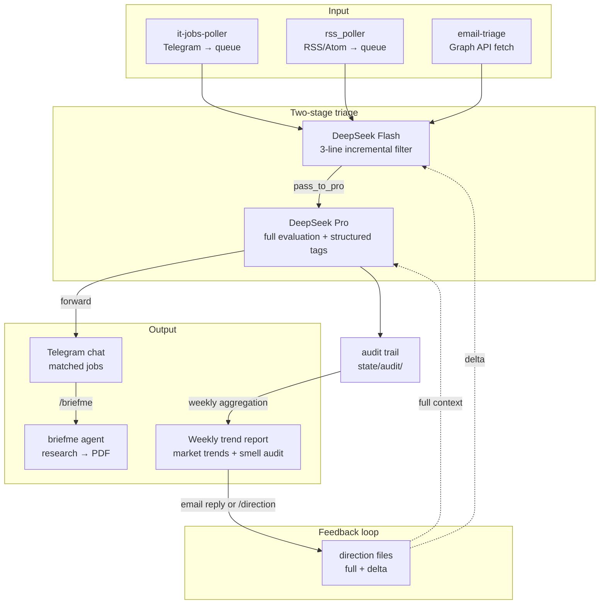

# telegram_MCP

Start here: [repository orientation and safe verification](ORIENTATION.md).

[](https://github.com/mknull/tg-infra/actions/workflows/ci.yml)

A self-contained job-market intelligence pipeline. Monitors Telegram groups, RSS/Atom job feeds, and Outlook folders, runs a two-stage DeepSeek triage to filter vacancies for relevance, delivers matches to a private Telegram chat, and adapts to user feedback over time. Built to run unattended under systemd.

## Architecture



## Pipeline detail

### Two-stage triage

Every message passes through Flash (`deepseek-v4-flash`) which reads 3 lines at a time and decides: `disqualified`, `read_more`, or `pass_to_pro`. Only messages Flash can't disqualify reach Pro (`deepseek-v4-pro`) for full body evaluation against the candidate's criteria. Most volume dies at Flash.

Pro extracts structured tags (role title, skills, domain, seniority, remote status) alongside the send/skip decision — the model already has the full text in context, so this costs nothing extra.

### Per-channel config, not per-channel code

Channel descriptions live in `state/channels.json` — each entry specifies what the channel is about, how messages are formatted, and what roles the user wants vs. will accept. The flash prompt is a fixed template; channel-specific values are interpolated at runtime. No channel-specific code paths.

### Matching setup

Run `./setup.sh` to configure matching, or
`jobsmcp/bin/python3 generate_profile.py --setup` to review matching settings alone.
Setup uses your documents and any additional preferences to generate Flash's
`desired_roles` / `acceptable_roles` for enabled Telegram channels and RSS feeds,
plus Pro's criteria. It previews the role preferences and criteria changes before
**Apply / Revise preferences / Later**. Feed subscriptions and intake filters stay
as configured.

On reinstall, **Keep existing** is the default and makes no model calls.
**Complete missing setup** fills empty/template fields while keeping personalized
values. **Regenerate** can reuse the current profile or read updated documents,
and previews replacements. Existing direction updates are retained.

Malformed Flash JSON or invalid source IDs/fields get one correction attempt.
Persistent failures are shown in the terminal and `state/setup.log`, with
**Retry / Later**. No model output is saved until the whole proposal is valid and
accepted. A deferred or incomplete setup exits nonzero and does not activate new
timers; existing running services are not stopped. `setup_verify.py status` reports
missing matching settings. Noninteractive `--stage2-only` fills missing settings;
adding `--force` explicitly replaces existing generated settings.

### RSS/Atom feeds

RSS 1.0/RDF, RSS 2.0, and Atom use the same collector.
[feeds.json.example](feeds.json.example) includes six enabled presets:

| Feed | Intake behavior |
| --- | --- |
| [FOSSJobs](https://www.fossjobs.net/rss/all/) | Full feed descriptions |
| [FSF](https://www.fsf.org/resources/jobs/RSS/) | Only titles beginning with “Job opportunity:”; excludes volunteer and information entries |
| [Open Source JobHub](https://opensourcejobhub.com/rss/) | Full feed descriptions |
| [We Work Remotely](https://weworkremotely.com/remote-jobs.rss) | Locally selects programming and DevOps categories; preserves category labels for triage |
| [NoDesk](https://nodesk.co/remote-jobs/index.xml) | Feed descriptions; explicitly repairs known HTML named entities in XML text |
| [Tails](https://tails.net/jobs/index.rss) | Allows a valid empty feed between openings; never infers closures |

All six endpoints were fetched successfully on 2026-10-18 (Asia/Nicosia).
Tails had no entries. Availability and feed contents can change; failures remain
visible in health checks. WWR category labels are publisher-supplied, so triage
still checks the actual job. FSF and NoDesk may provide summaries rather than
full postings; source links are retained.

```bash
jobsmcp/bin/python3 -m pip install -r requirements.txt
# First-time configuration only; preserve an existing feeds.json.
cp -n feeds.json.example state/feeds.json
jobsmcp/bin/python3 rss_poller.py
./audit rss --content
```

Review enabled sources before running: the collector queues **all currently
available entries matching each feed's filters on its first run**. The
existing `job-triage` timer evaluates them against `state/it-jobs-criteria.md` and
delivers matches; `/briefme` and weekly reporting include feed content. Feed titles,
original URLs, and application links are preserved. The collector does not crawl linked pages.

Add another object to `state/feeds.json` with a unique stable `id`, `name`, and `url`;
`desired_roles` and `acceptable_roles` tune Flash. Set `enabled` to `false` to pause
both polling and pending triage for that feed. Missing configuration disables RSS.
For an existing deployment, merge the additional presets into its existing
configuration; installation preserves that file.

Optional selectors `include_title_prefixes` and `include_categories` are lists
matched without regard to case (categories match exactly). Empty lists accept all
titles/categories. When both are present, both must match. Changing selectors
forces a fresh fetch so newly included entries are reconsidered.
`repair_html_entities` is enabled only for NoDesk's known publisher defect;
unknown entities and malformed XML still fail. `allow_empty` is enabled only for
Tails; other empty feeds remain errors. Neither option changes stored raw responses.

`setup.sh` seeds these presets on fresh installs and generates
`rss-poll.service` / `rss-poll.timer`, scheduled daily at **06:10 host local time**.
Existing deployments need the new unit installed and enabled; editing this repository
alone does not activate it. `./setup.sh` installs the new timer through the existing
setup/verification flow. The collector itself makes no model calls or deliveries.

Each feed keeps a persistent JSON index under `state/rss/<id>/` plus raw response
snapshots and poll status. Identity uses the feed's entry ID, falling back to its
URL. A changed description creates a new queued revision of the same job; unchanged
polls and publication-date-only changes do not requeue it. Disappearing entries remain
in the index and are never inferred closed. This first channel does not attempt
cross-feed duplicate matching or a full job catalog/export.

HTTP fetching uses conditional requests, timeouts, a 2 MiB response limit, and bounded
retries. Malformed, unexpectedly empty, or blocked feeds fail independently without advancing their
index. `./audit --health` reports feed failures and polls older than 48 hours.
For RSS it also reconciles the ingestion index, arrivals, queue, Flash/Pro decisions
and delivery acknowledgements by message revision. It fails on items unfinished
after one hour, missing arrivals, invalid/dead-lettered decisions, duplicate
evaluations or deliveries, and sends without a matching successful delivery result.
Unfinished items, latest failed evaluations and unacknowledged sends are checked
even outside `--days`; historical evaluation/duplicate checks use that window.
Queued items from disabled feeds
are reported as paused. Poll counters expose source filtering; HTTP 304 is healthy.
Audit verifies recorded processing and delivery-service acceptance, not relevance
judgments or vacancies that a publisher never exposed in the configured feed.
Raw snapshots and the index are retained without automatic pruning.

Run the isolated RSS tests with:

```bash
jobsmcp/bin/python3 -m unittest tests.test_rss tests.test_rss_audit tests.test_rss_e2e tests.test_system_setup -v
```

The process-level tests launch the collector, triage worker and audit CLI in a
temporary project with a loopback HTTP server. They verify delivery, unchanged
reruns (HTTP 200 and 304), changed revisions, source failure isolation and recovery
from a model outage. External API endpoints are redirected by the test harness;
no real model calls or Telegram messages are made. CI discovers these tests
automatically. Live deployment credentials and service availability still need
the existing setup verification and delivery canary.

### `/briefme` agent

A DeepSeek function-calling agent. The user quotes a job and replies `/briefme` — the agent loads profile files, searches for the company, fetches the listing, and produces a decision-grade brief covering the role, environment, and career-strategic fit. Output is converted to PDF and sent as a Telegram document.

Tools are guardrailed: URL validation with trusted-domain fast-path (unknown domains blocked), filesystem sandbox (`.resolve()` on every path), query injection detection, content sanitisation with closing-tag stripping, and a per-brief rate limiter. 34 adversarial tests verify each layer fails closed.

### Adaptive direction

The user's profile is generated from documents, but preferences drift. The weekly
report invites corrections through email replies or `/direction`. Flash receives
the compressed update; Pro receives the full update, for both Telegram/RSS and
email. Weekly analysis and briefs also receive the full update. Explicit updates
override conflicting base preferences.

`state/current-direction.json` publishes the full and compressed forms as one
version. Both must be generated successfully before publication. A failed update
keeps the previous version and reports the failure. The `.md` direction files
are compatibility exports; existing installations containing only those files
are still supported. Use `/direction` or setup to change preferences once the
JSON version exists.

### Audit discipline

Every decision across every pipeline is recorded to `state/audit/`. The `./audit` CLI surfaces:

- **Default view** — recent records with inline duplicate warnings
- **`--summary`** — per-source stats (records vs unique, decision distributions)
- **`--topology`** — expected vs actual cascade paths with deviation detection
- **`--health`** — exits 1 on duplicate evals, broken cascades, direction sync issues, prompt size bloat, delivery failures, agent errors

The audit found the cursor precision bug, the false-positive minute-granularity issue, and the broken cascade from the pre-fix duplicate runs — each before the user noticed them in production.

### Web search isolation

The agent's `web_search` targets a self-hosted [SearXNG](https://github.com/searxng/searxng) instance in Docker, bound to `127.0.0.1`. No third-party search API, no API keys, no rate limits. The agent's filesystem sandbox can't reach it directly — only the `web_search` tool function can.

## Regulatory scope

This repository includes a deployment-specific
[EU AI Act assessment](EU_AI_ACT_NOTICE.md) describing its intended use
and the changes that could alter its regulatory classification.

## Project structure

```
├── lib/                    config, api, delivery, direction, auth, audit, graph, log, onboarding, seen, state, weekly_ledger
├── guardrails.py           Agent tool access control
├── tools.py                Agent tools (read_file, web_search, web_fetch, md_to_pdf)
├── agent.py                DeepSeek function-calling loop + system prompt
├── audit                   CLI audit tool
│
├── it_jobs_poller.py       Telethon poller (Telegram groups → queue)
├── rss_poller.py           RSS/Atom collector (configured feeds → queue)
├── it_jobs_triage.py       Queue → incremental Flash → Pro → delivery
├── email_triage.py         Outlook Graph API → Flash → Pro → delivery
├── email-ingest-wrap       Email ingest + audit health check + Telegram alert
│
├── bot_commands.py         Telegram bot (/briefme, /direction, /start, /status)
├── weekly_trend.py         Weekly market report + smell investigation
├── weekly_recovery.py      Retries the weekly report until confirmed sent
├── outlook_auth.py         One-time Outlook OAuth device-code flow
├── feedback_poller.py      Polls Outlook for replies to weekly reports
├── generate_profile.py     Two-stage profile generation from user documents
│
├── setup.sh                Installer (systemd unit generation)
├── setup_verify.py         Verifies an install is configured + delivering
├── delivery_canary.py      Synthetic message through the real deliver() path
│
├── state/                  Runtime state (cursors, audit, queue, config, tokens)
├── state/channels.json     Per-channel descriptions, desired/acceptable roles
├── channels.json.example   Seed for state/channels.json on a clean checkout
├── feeds.json.example      FOSSJobs preset for state/feeds.json
├── source/                 Profile inputs (interests, skills, tech_stack)
├── tests/                  Unit and integration tests; feeds use offline fixtures
│
├── .github/workflows/ci.yml  CI: unittest suite + audit health check
└── requirements.txt        telethon, markdown, weasyprint, playwright, feedparser
```

## Dependencies

- Python ≥ 3.10, a single venv
- DeepSeek API (flash + pro models)
- Microsoft Graph API (Outlook email — optional)
- Telethon (Telegram MTProto user-API)
- SearXNG (self-hosted metasearch, Docker)
- systemd (user timers, no root)

No LangChain. No hosted scrapers. No proprietary search APIs.


